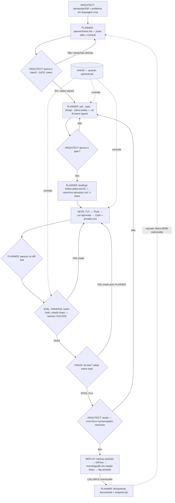

# Ciclo de vida de uma DEM — fluxo e gates

> O caminho completo de uma demanda, do problema cru à entrega publicada. O único ponto que a maioria dos processos não tem é o **gate de objetivo** (`GATE: intent`), antes de qualquer spec.

## Fluxo completo

## As fases, uma a uma

### Fase 0 — Intent (o porquê)
- **Dono de escrita:** PLANNER. **Dono de assinatura:** ARQUITECT.
- O ARQUITECT descreve o problema em linguagem crua. O PLANNER pergunta como **analista** (quem sente, o que "melhor" significa em estado observável, o que fica de fora, o que **não pode piorar**, o que ainda não se sabe) e **redige** `planner/intent.md` no template — **sem escolher solução**.
- **Gate:** `GATE: intent`. O ARQUITECT fecha as perguntas abertas e muda `status: signed`. **Só então** o PLANNER abre a spec.
- Detalhe: [`../03-camada-intent/camada-intent.md`](../03-camada-intent/camada-intent.md).

### Fase 1 — Especificação (o quê)
- **Dono:** PLANNER. Escreve `planner/`: `prd.md` → `spec.md` → `design.md` → `plano-testes.md`, **lendo só o intent signed**.
- Cada capacidade da spec **cita** um outcome (§2), um non-goal (§4 Out) ou uma constraint (§5) do intent. Capacidade órfã = a spec inflou.
- **Gate:** o ARQUITECT aprova a spec.

### Fase 2 — Briefings (o handoff)
- **Dono:** PLANNER. Escreve o `briefing.md` de cada agente que vai atuar (`dev/`, `eval/`, `vision/`, `deploy/`).
- Todo briefing abre com o cabeçalho de despacho `PARA: / DEM: / GATE:` e carrega os **caminhos absolutos** (docs + código + o intent). Ver [`../01-papeis/protocolo-de-despacho.md`](../01-papeis/protocolo-de-despacho.md).

### Fase 3 — Implementação (o como)
- **Dono:** DEVS, na branch `feature/*`, via **TLC** (Think → List aprovado → Code). Escreve `dev/jornada.md` **em tempo real**.
- Dúvida/escopo faltando → **para e devolve ao PLANNER**; nunca executa sobre assunção não confirmada.
- **Gate intermediário:** o PLANNER emite **parecer sobre o diff real** (não sobre o relato).

### Fase 4 — Validação (o porteiro)
- **EVAL:** QA lógico-funcional. Roda o `planner/plano-testes.md` **em estado limpo**, emite veredito `PASS|FAIL|BLOCKED` **amarrado a hash**, com evidência por caso (rastreio **F/H/C/N/G**). Não corrige código; não muda critério.
- **VISION** (só se há tela): valida UI/UX **em navegador real** sobre o hash; correção volta como **lista** ao PLANNER, que a tria contra o código antes de virar tarefa dos DEVS.
- **Gate:** aceite do ARQUITECT — inclui a parte não-automatizável (ex.: fluxo humano, decisões sensíveis).

### Fase 5 — Publicação
- **DEPLOY:** executa o GitFlow com gates completos (backup pareado antes de release; homologação em estado limpo; `feature → develop`, `master`/`main` só via `release/*`). Escreve `deploy/jornada.md` e devolve um **CALLBACK estruturado**. Ver [`../04-estrutura-dem/gitflow.md`](../04-estrutura-dem/gitflow.md).

### Fase 6 — Fechamento
- **PLANNER:** consolida o `changelog.md`, atualiza o painel de DEMs, faz o rollup de tempo/tokens e o **snapshot git** da documentação. A cascata libera as DEMs que dependiam desta.

## Os gates (todos não-bypassáveis)

| Gate | Quem assina | Pré-condição verificada |
|---|---|---|
| `intent` | ARQUITECT | `planner/intent.md` no disco, `status: signed` |
| `spec` | ARQUITECT | spec aprovada; 100% das capacidades citam o intent |
| `eval` | EVAL | veredito PASS sobre hash existente, em estado limpo |
| `vision` (se há tela) | VISION → PLANNER tria | validado sobre hash, em navegador real |
| aceite de entrega | ARQUITECT | inclui fluxo humano / decisões sensíveis |
| aceite de release | ARQUITECT | homologação em estado limpo + backup pareado |

## Definition of Ready / Done por fase

| Para entrar em… | Precisa ter… |
|---|---|
| **Intent** | problema em linguagem crua do ARQUITECT |
| **Spec** | `intent.md` `signed`; `prd.md` sem ambiguidade pendente |
| **Design** | `spec.md` aprovada, requisitos verificáveis, contratos se houver |
| **Implementação** | documentos anteriores aprovados; ADRs relevantes citadas |
| **Fechamento** | testes verdes cobrindo os requisitos; hash do commit; checklist de regressão arquitetural OK |

**Done de fase** = documento completo (sem `[placeholder]`) + ARQUITECT aprovou + conflitos com ADRs sinalizados + itens em aberto registrados.

> Próximo: [`../01-papeis/papeis-e-interacoes.md`](../01-papeis/papeis-e-interacoes.md) — as fichas de cada papel.
